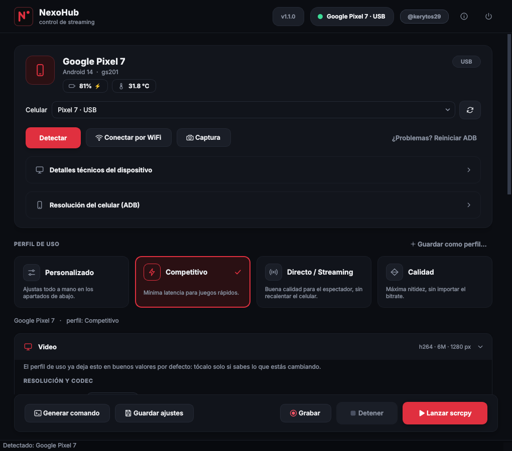

# NexoHub

Mira más proyectos en el [portafolio](https://portafolio-rho-snowy.vercel.app/).

Detecta tu celular Android, tu topología USB, tu monitor y tu CPU, y arma
automáticamente el comando `scrcpy` óptimo para tu equipo. Todo desde una
interfaz gráfica (PyQt6) o desde la terminal, y todo ajustable sin tocar código.



## Qué incluye

- **Detección automática** del celular (modelo, chipset, encoders de hardware), de la
  velocidad USB real, del monitor y del CPU governor. Si enchufas el celular,
  se detecta solo.
- **Tarjeta del celular** con batería, temperatura (avisa si se calienta), tipo de
  conexión y selector cuando hay varios celulares.
- **Perfiles de uso** (Competitivo, Directo/Streaming, Calidad) y **perfiles propios**:
  «Guardar como perfil…» y aparecen como una tarjeta más.
- **Video**: codec, encoder, bitrate, tamaño máximo, FPS máximo, buffer de video y
  overlay de FPS en vivo.
- **Ventana y pantalla**: pantalla completa, siempre encima, sin bordes, título propio,
  orientación, mantener el celular despierto, apagar su pantalla, mostrar toques.
- **Audio** por 4 rutas (apagado, USB, Bluetooth, WiFi en paralelo).
- **Teclado, mouse y mando** (`uhid`, `aoa`, `sdk`) y reenvío de gamepad.
- **Mapeo de teclas a toques** como en los emuladores (BlueStacks, Panda Mouse): WASD,
  cámara con el mouse y teclas sobre los botones del juego, con editor visual. No
  instala nada en el celular. Trae un mapa para Free Fire.
- **Grabación** de la sesión (mkv/mp4) y **capturas de pantalla** del celular, que además
  quedan en el portapapeles.
- **WiFi/LAN** sin cable, **resolución del celular** por ADB y arreglos de USB power y
  CPU governor con contraseña gráfica (`pkexec`).
- **Dependencias**: verifica e instala lo que falte (pacman, apt, dnf, zypper).
- **Línea de comandos** completa (`main.py`), con el mismo motor que la interfaz.

## Instalación

```bash
./install.sh
```

Copia el programa a `~/.local/share/nexohub`, instala las dependencias de Python para tu
usuario y crea el lanzador `nexohub` y una entrada de menú. Tus ajustes **no** viven ahí
sino en `~/.config/nexohub/config.yaml`, así que actualizar nunca los pisa (si venías de
una versión anterior a la 1.1, lo que habías cambiado se migra solo). Para desinstalar:
`./uninstall.sh`.

Las dependencias del *sistema* (adb, scrcpy, cpupower, polkit) se instalan desde la
sección **Dependencias** de la propia app (pide la contraseña en una ventana gráfica con
`pkexec`, nunca en la terminal).

**A mano (Arch Linux):**

```bash
sudo pacman -S scrcpy android-tools cpupower polkit python python-pip
pip install -r requirements.txt --break-system-packages
python gui.py
```

`polkit` es lo que provee `pkexec`. En Hyprland (a diferencia de GNOME/KDE) no viene un
agente gráfico de polkit: instala y arranca uno junto con tu sesión, por ejemplo
`hyprpolkitagent` o `polkit-gnome`, o `pkexec` no podrá mostrar el diálogo de contraseña.

Requiere Python 3.9 o superior.

## Uso: interfaz gráfica

```bash
nexohub          # si lo instalaste con install.sh
python gui.py    # desde la carpeta del proyecto
```

Es una sola pantalla, sin pasos obligatorios: arriba el celular y el perfil de uso, abajo
los ajustes finos en secciones plegables (cada una muestra un resumen de lo que tiene
puesto) y, siempre a la vista, la barra con **Generar comando**, **Guardar ajustes**,
**Grabar**, **Detener** y **Lanzar scrcpy**.

| Atajo | Acción |
| --- | --- |
| `F5` | Detectar celular |
| `Ctrl+Enter` | Lanzar scrcpy |
| `Ctrl+.` | Detener la transmisión |
| `Ctrl+S` | Guardar ajustes |
| `F12` | Captura de pantalla del celular |
| `F1` | Acerca de (versiones, rutas, atajos) |
| `Ctrl+Q` | Salir |

El chip de arriba muestra el celular conectado y, mientras transmites, `En vivo`, el
tiempo transcurrido y los FPS.

### Capturas y grabación

- **Captura** (botón de cámara o `F12`): usa `adb exec-out screencap`, así que funciona
  aunque no estés transmitiendo. Se guarda en `~/Pictures/NexoHub` y se copia al
  portapapeles.
- **Grabar**: actívalo antes de lanzar. Guarda en `~/Videos/NexoHub` (mkv o mp4). Ojo:
  scrcpy solo graba el audio de la ruta «Por USB, junto con el video»; con las demás la
  grabación sale sin audio y la app te lo avisa.
- Las carpetas se pueden cambiar en la sección **Grabación y capturas**.

### Perfiles

Un perfil es un conjunto de ajustes (video, ventana, audio, entrada…). Los tres de
fábrica están en `config.yaml`; los tuyos se guardan en tu archivo de usuario.
Si editas a mano algo que forma parte de un perfil, la selección pasa a «Personalizado».
Clic derecho sobre un perfil propio para eliminarlo.

## Uso: línea de comandos

```bash
python main.py --list-devices                 # celulares que ve ADB
python main.py --diagnose                     # solo el diagnóstico
python main.py --print-command                # arma el comando sin ejecutarlo
python main.py --auto                         # detecta todo y lanza scrcpy
python main.py --auto --profile competitive   # con un perfil
python main.py --auto --record                # grabando la sesión
python main.py --screenshot                   # captura de pantalla y sale
python main.py --serial R58M12ABCD --auto     # elegir celular si hay varios
python main.py --auto --fix-usb-power --fix-cpu-governor
python main.py --auto --wifi --wifi-port 5566 # pasar a WiFi/LAN (primero por USB)
```

Si el monitor no se puede leer (por ejemplo en Wayland puro sin `screeninfo`), la línea de
comandos asume 1920×1080 y te lo avisa; la interfaz gráfica usa en cambio los datos de Qt.

## Configuración

Hay dos capas:

1. `config.yaml` junto al programa: los valores de fábrica, con cada opción documentada.
   **No se edita** (se reemplaza al actualizar).
2. `~/.config/nexohub/config.yaml`: solo lo que tú cambias. Lo escribe la app con
   «Guardar ajustes» y también puedes editarlo a mano. Borrarlo, o usar
   «Restablecer ajustes» en la sección **Avanzado**, vuelve a los valores de fábrica.

Cualquier valor que pongas sobreescribe la detección automática; si lo dejas vacío, se
detecta solo. El registro de actividad está en `~/.local/state/nexohub/nexohub.log`
(rotativo, también visible en la sección **Comando y registro**).

## ¿Funciona con cualquier celular?

Sí: todo lo específico del chipset (el nombre del encoder de video) se detecta en vivo
con `scrcpy --list-encoders`, nunca se asume un fabricante. Los perfiles solo fijan el
códec deseado (h264/h265); el encoder exacto (MediaTek, Qualcomm, Exynos, Unisoc…) se
resuelve según el celular conectado en ese momento.

## WiFi / LAN (sin cable)

Una vez que el celular fue detectado por USB, se puede seguir usando sin cable:

- **GUI**: botón «Conectar por WiFi» en la tarjeta del celular. Activa `adb tcpip`, conecta
  por la IP del celular y ya se puede desenchufar el cable. El botón pasa a «Volver a USB».
- **CLI**: flag `--wifi`.

El celular y el PC tienen que estar en la **misma red** (no sirve por internet). Espera
más latencia y variabilidad que por cable: no se recomienda para uso competitivo, pero
funciona bien para mirar o controlar el celular sin estar atado al cable.

## FPS en vivo, overlay y detener

- **FPS máximo** agrega `--max-fps=N` (0 = sin límite).
- **Overlay de FPS** activa `--print-fps` y muestra los FPS reales en una placa flotante,
  fija en una esquina y por encima de todo (incluida la ventana de scrcpy en pantalla
  completa) con `wlr-layer-shell` vía `gtk-layer-shell` (opcional, instalable desde
  **Dependencias**). Sin él, cae a una ventana Qt común (en Wayland/Hyprland puede no
  quedar fija ni «siempre encima»).
- Si el FPS o el bitrate superan un umbral razonable para USB 2.0/WiFi (60 FPS / 20 Mbps)
  aparece un aviso.
- **Detener** corta scrcpy (SIGTERM y, si no responde en 4 s, SIGKILL) sin cerrar NexoHub.
  Al cerrar la ventana con una transmisión activa, la app te pregunta antes.

## Resolución del celular (ADB)

En la tarjeta del celular, sección **Resolución del celular (ADB)**:

- Cambia la resolución *real* de la pantalla del celular con `adb shell wm size`. Es
  distinto del «Tamaño máx.» del video, que solo reescala la imagen capturada. Sirve para
  que el juego renderice directo al tamaño final.
- **Usar la de mi monitor** llena los campos con la resolución del monitor en vertical
  (1920×1080 → 1080×1920) sin aplicar nada todavía. **Aplicar** la manda al celular y
  **Restablecer a nativa** vuelve a la de fábrica en cualquier momento.
- Una resolución no nativa puede hacer que algunos lanzadores o juegos se vean o se
  comporten raro. No se guarda en la configuración: dura hasta reiniciar el celular o hasta
  que la restablezcas.

## Audio: 4 rutas para evitar el lag en competitivo

Si el audio comparte el mismo túnel USB/ADB que el video y el control, el celular tiene
que codificar audio y video a la vez por el mismo cable; en USB 2.0 (o con un chipset ya
exigido por el juego) eso alcanza para meter delay en el input aunque el audio suene bien.

1. **Apagado (sin audio)**: la más segura. Se escucha el sonido directo del celular.
2. **Por USB, junto con el video**: audio normal de scrcpy. Si hay lag, prueba en este
   orden: codec `aac` (suele tener encoder de hardware), bitrate `64K`, y bajar el buffer
   (50 → 30 → 15 ms).
3. **Bluetooth**: el celular se empareja con el PC y se elige el PC como salida de audio.
   Nunca pasa por scrcpy: cero impacto en video/input. Contra: ~100-150 ms de desfasaje
   típico de A2DP (baja con aptX Low Latency o LC3). El botón «Bluetooth» muestra si el PC
   tiene adaptador y qué dispositivos hay emparejados; el emparejamiento se hace desde el
   applet de Bluetooth del sistema.
4. **WiFi en paralelo (dual)**: video y control por USB y una segunda instancia de scrcpy,
   invisible, trae solo el audio por WiFi, un canal distinto del cable. Requiere Android 11+.
   Android pedirá confirmar un permiso la primera vez.

Si nada alcanza, revisa el cable y el puerto: el diagnóstico avisa si detecta USB 2.0.

## Mapeo de teclas a toques

Para jugar con teclado y mouse títulos pensados para pantalla táctil (Free Fire, etc.),
como en los emuladores, pero con el juego corriendo en el celular.

1. En **Teclado, mouse y mando**, marca **Activar al lanzar scrcpy** y elige el mapa.
2. **Editar mapa…** abre el editor: saca una captura del celular (mejor dentro de una
   partida o del campo de entrenamiento, para ver todos los botones) y arrastra cada
   círculo sobre su botón. Para cambiar una tecla, pulsa su botón y después la tecla o el
   botón del mouse que quieras.
3. Lanza scrcpy y usa estas teclas (todas se cambian en el editor, también por botones
   del mouse):

   | Tecla | Acción |
   | --- | --- |
   | `F9` | Activa y desactiva el mapeo (modo juego): WASD mueve, el mouse apunta, clic dispara… |
   | `F8` | Pausa y reanuda sin desactivar (para escribir en el chat, usar el PC un momento) |
   | `Alt` | Suelta el cursor para tocar menús; otra vez `Alt` vuelve a la cámara |
   | `F10` | Abre el editor aunque estés jugando; al guardar se aplica al instante |
   | `F7` | Muestra u oculta las teclas dibujadas sobre el juego |
   | `F6` | Abre los ajustes rápidos (sensibilidad de la cámara en vivo); al cerrarlos vuelves al juego |

   Las teclas que el mapa no usa (Esc, Enter, Alt+Tab, Super) siguen funcionando en el PC.

Mientras juegas, cada tecla se dibuja encima de su botón, sobre la ventana de scrcpy (como
BlueStacks). Usa `wlr-layer-shell` (gtk-layer-shell) y `hyprctl` para ubicar la ventana,
así que por ahora solo se ve en Hyprland; el mapeo en sí funciona en cualquier escritorio.

**Cámara**: la sensibilidad horizontal y la vertical se ajustan por separado en el editor
(control «Cámara»). Si la cámara queda lenta, sube primero la sensibilidad *dentro de Free
Fire* y después la de NexoHub: así el dedo virtual recorre menos y casi nunca se tiene que
reapoyar. El tamaño de cada tecla se cambia con la rueda del mouse encima de ella o con
«Tamaño».

Cómo funciona: los toques viajan por una segunda sesión de `scrcpy-server` (el mismo que
trae scrcpy), solo de control, así que no queda nada instalado en el celular y la latencia
es la de scrcpy. El teclado y el mouse se leen del kernel con `evdev` (en Wayland una app
no puede capturarlos de otra forma), por eso hace falta:

- estar en el grupo `input` (`sudo usermod -aG input $USER` y volver a iniciar sesión);
- el paquete de Python `evdev` (en Arch: `python-evdev`, también desde **Dependencias**);
- el módulo `uinput` del kernel, para que las teclas no mapeadas sigan llegando al PC. Si
  NexoHub avisa que el kernel se actualizó, reinicia la PC.

Los mapas propios se guardan en `~/.config/nexohub/keymaps/<nombre>.yaml` (los de
fábrica están en `keymap/presets/` y no se modifican). Sin interfaz:

```bash
python -m keymap --map freefire                 # F10 modo juego, Ctrl+C para salir
python -m keymap --map freefire --device R85HE  # usar solo ese teclado/mouse
```

## Desarrollo

```bash
pip install -r requirements-dev.txt
python -m pytest        # ~110 pruebas, Qt en modo offscreen
```

Las pruebas de interfaz usan un `adb` y un `scrcpy` simulados (`tests/fakes/`), así que no
hace falta un celular ni una pantalla. Se ejecutan en GitHub Actions (`.github/workflows`).

```
gui.py               punto de entrada de la interfaz
main.py              línea de comandos
command_builder.py   reglas que arman el comando de scrcpy
autoconfig.py        detección + perfiles (compartido por GUI y CLI)
config_store.py      configuración en dos capas, escritura atómica
adb_tools.py         lista de celulares, batería, capturas, versiones
detectors/           celular, USB, monitor, CPU, WiFi, Bluetooth, dependencias…
keymap/              mapeo de teclas: modelo, sesión de control, motor, evdev
ui/                  ventana, pantalla principal, páginas, widgets, tema, íconos
tests/               pruebas (incluye tests/fakes/ con adb/scrcpy simulados)
```

## Pendiente

- Mapeo de teclas: macros, deslizar, toque repetido, rueda del mouse; teclas en pantalla
  fuera de Hyprland.
- Motor de reglas genérico y base de chipsets por fabricante.
- Multiplataforma (Windows/macOS) y empaquetado (AUR/Flatpak).

Consulta el [CHANGELOG](CHANGELOG.md) para el detalle de cada versión.

## Licencia

MIT. Consulta el archivo [LICENSE](LICENSE) para el texto completo.
